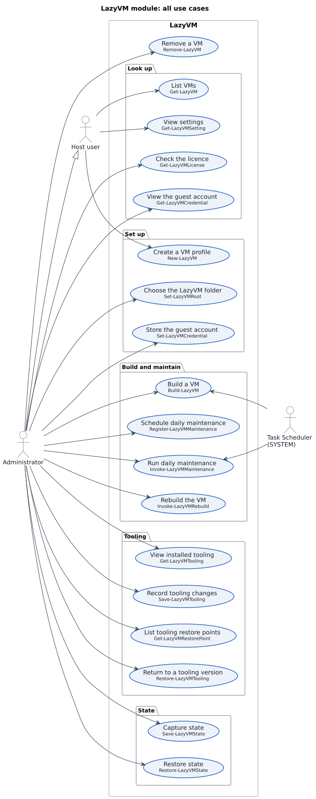
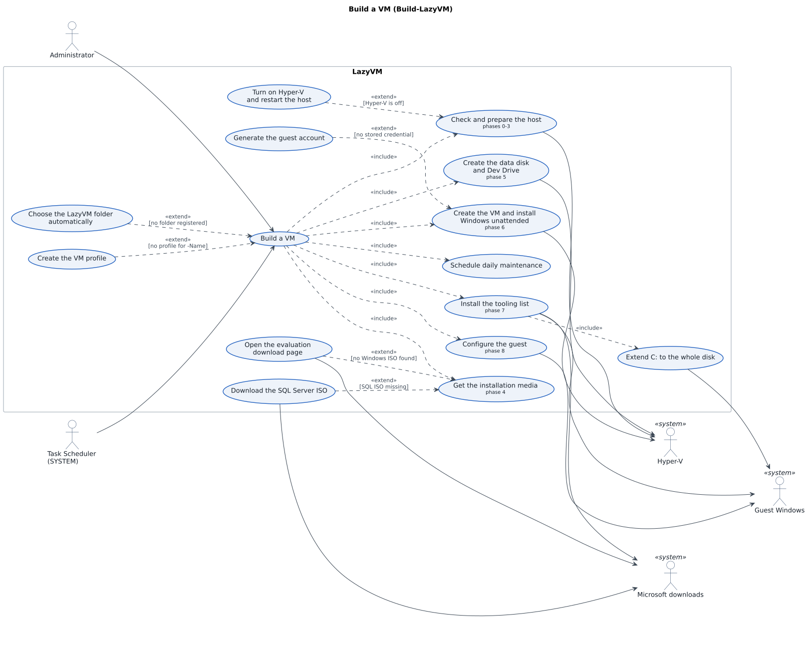
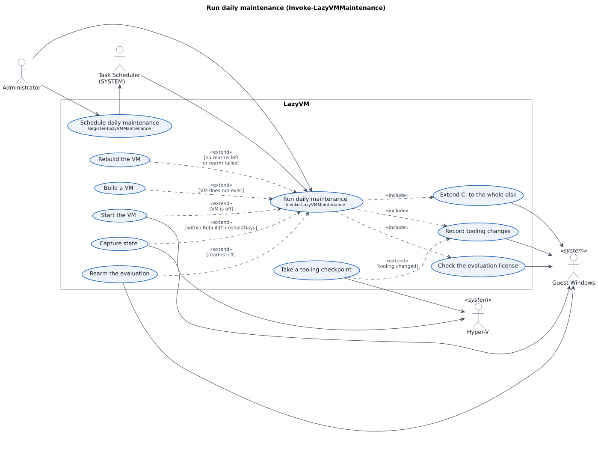
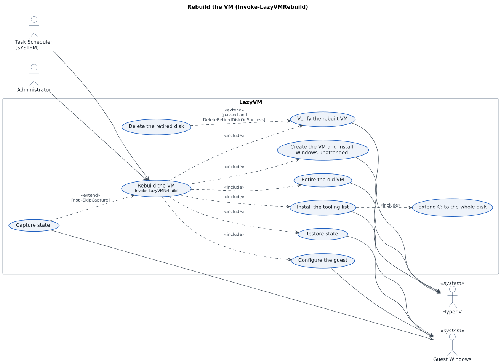
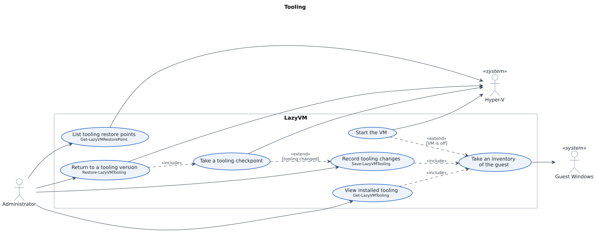
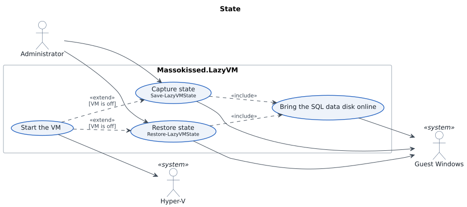
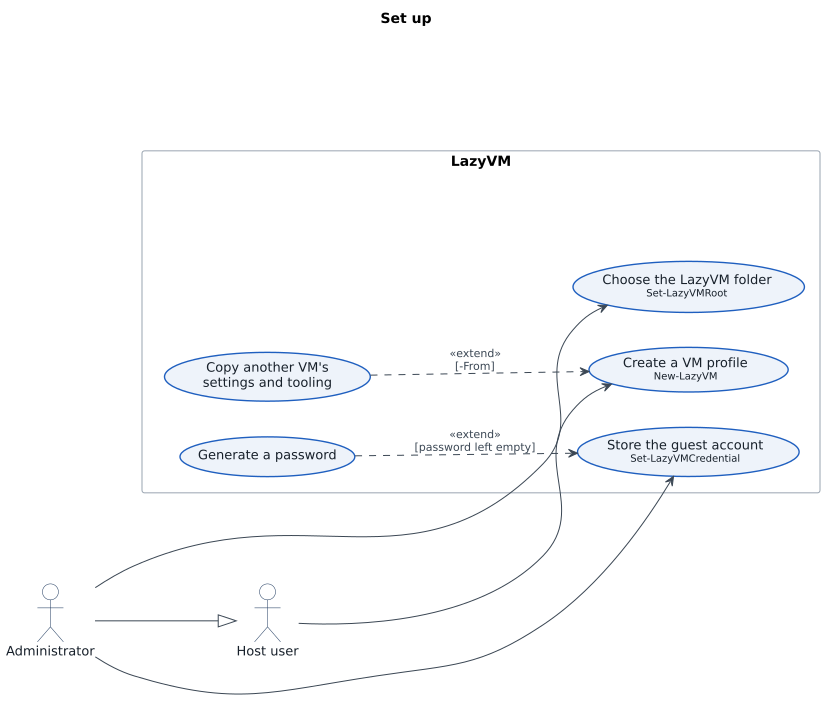
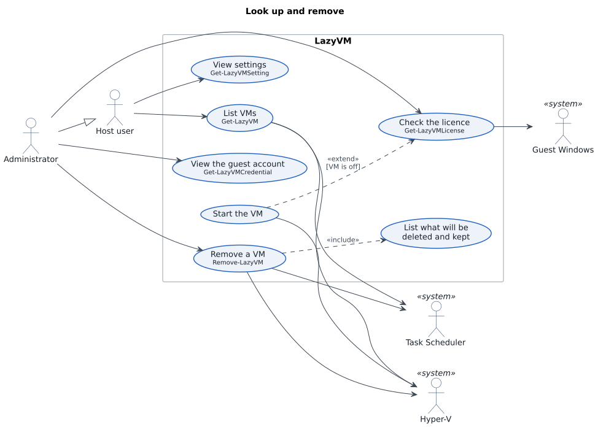
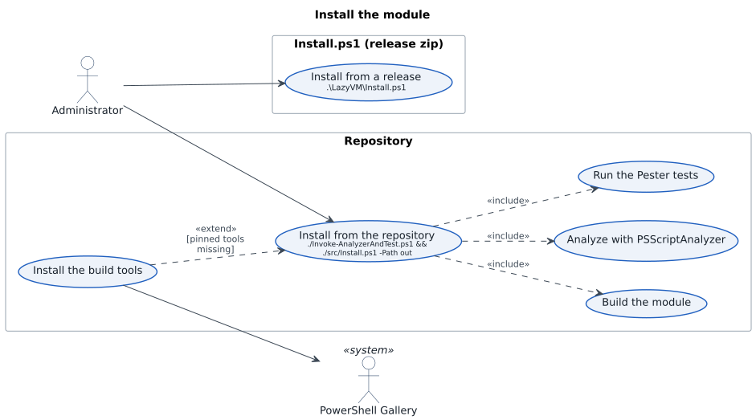

# LazyVM use cases

UML use case diagrams for the LazyVM module, drawn from the code in `src/`, not from the plans. Each diagram is followed by the same information as text.

[Diagrams.md](Diagrams.md) shows how each use case works inside: the calls in order and the data each one reads and writes.

## How to read them

- A **stick figure** is an actor. The ones on the left start a use case. The ones marked «system» on the right are what LazyVM works with: Hyper-V, Windows inside the VM, Task Scheduler and download sites.
- An **oval** is a use case. Where one is a command, its name is underneath.
- **«include»** points to a use case that always runs as part of another.
- **«extend»** points from a use case that runs only sometimes. The condition is in square brackets.
- **Administrator** is a Host user with an elevated PowerShell (the hollow arrow). Every command needs one except `Get-LazyVM`, `Get-LazyVMSetting` and `New-LazyVM`.

## Contents

1. [All use cases](#1-all-use-cases)
2. [Build a VM](#2-build-a-vm)
3. [Run daily maintenance](#3-run-daily-maintenance)
4. [Rebuild the VM](#4-rebuild-the-vm)
5. [Tooling](#5-tooling)
6. [State](#6-state)
7. [Set up](#7-set-up)
8. [Look up and remove](#8-look-up-and-remove)
9. [Install the module](#9-install-the-module)

## 1. All use cases



Actors: Host user, Administrator (a Host user), Task Scheduler running as SYSTEM.

- Host user: List VMs (`Get-LazyVM`), View settings (`Get-LazyVMSetting`), Create a VM profile (`New-LazyVM`).
- Administrator, also:
  - Look up: Check the licence (`Get-LazyVMLicense`), View the guest account (`Get-LazyVMCredential`).
  - Set up: Choose the LazyVM folder (`Set-LazyVMRoot`), Store the guest account (`Set-LazyVMCredential`).
  - Build and maintain: Build a VM (`Build-LazyVM`), Schedule daily maintenance (`Register-LazyVMMaintenance`), Run daily maintenance (`Invoke-LazyVMMaintenance`), Rebuild the VM (`Invoke-LazyVMRebuild`).
  - Tooling: View installed tooling (`Get-LazyVMTooling`), Record tooling changes (`Save-LazyVMTooling`), List tooling restore points (`Get-LazyVMRestorePoint`), Return to a tooling version (`Restore-LazyVMTooling`).
  - State: Capture state (`Save-LazyVMState`), Restore state (`Restore-LazyVMState`).
  - Remove a VM (`Remove-LazyVM`).
- Task Scheduler: Run daily maintenance (task `LazyVM-Maintain-<VM>`), and Build a VM again after the host restarts to turn on Hyper-V (task `LazyVM-ResumeAfterReboot-<VM>`).

## 2. Build a VM



Actors: Administrator; Task Scheduler (resumes the build after a restart). Systems: Hyper-V, Guest Windows, Microsoft downloads.

Build a VM includes:

- Check and prepare the host (phases 0-3). Extended by **Turn on Hyper-V and restart the host** when Hyper-V is off; the build then resumes at phase 3 by itself.
- Get the installation media (phase 4). Extended by **Open the evaluation download page** when no Windows ISO is found, and by **Download the SQL Server ISO** when it is missing.
- Create the data disk and Dev Drive (phase 5). Existing disks are never overwritten.
- Create the VM and install Windows unattended (phase 6). Extended by **Generate the guest account** when no credential is stored.
- Install the tooling list (phase 7), which includes **Extend C: to the whole disk**. Tooling comes from the VM's `Tooling.json`, or the module's `Tooling.Default.json` for a new VM.
- Configure the guest (phase 8): SQL data files to D:, Visual Studio settings, databases restored from D:\SQLBackup.
- Schedule daily maintenance.

Build a VM is extended by:

- **Choose the LazyVM folder automatically** when no folder is registered: LazyVM on the NTFS drive with the most free space.
- **Create the VM profile** when there is none for `-Name`.

## 3. Run daily maintenance



Actors: Task Scheduler (daily at `MaintenanceTime`, as SYSTEM), Administrator. Systems: Hyper-V, Guest Windows.

Run daily maintenance includes, every day:

- Extend C: to the whole disk. It takes a checkpoint first and moves the recovery partition to the end of the disk, so it works with BitLocker on.
- Record tooling changes. Extended by **Take a tooling checkpoint** when the tooling changed.
- Check the evaluation licence.

It is extended by:

- **Start the VM** when the VM is off.
- **Capture state** when the evaluation is within `RebuildThresholdDays` (10) of expiry.
- **Rearm the evaluation** when rearms are left.
- **Rebuild the VM** when no rearms are left or the rearm failed.
- **Build a VM** when the VM does not exist.

Schedule daily maintenance (`Register-LazyVMMaintenance`) registers the task with Task Scheduler. Build a VM does this too.

## 4. Rebuild the VM



Actors: Administrator (`Invoke-LazyVMRebuild`), Task Scheduler (through daily maintenance). Systems: Hyper-V, Guest Windows.

Rebuild the VM includes:

- Retire the old VM: removes its checkpoints and definition and renames its Windows disk aside. The data disk and Dev Drive are not touched.
- Create the VM and install Windows unattended.
- Install the tooling list, which includes **Extend C: to the whole disk**.
- Configure the guest.
- Restore state.
- Verify the rebuilt VM: running and reachable, tooling-list products and SQL Server installed, captured databases online, D: and W: mounted. Extended by **Delete the retired disk** when verification passed and `DeleteRetiredDiskOnSuccess` is on. If it failed, the retired disk is kept and the log gives the rollback commands.

It is extended by **Capture state** unless `-SkipCapture` is given. Maintenance passes `-SkipCapture` because it has just captured.

## 5. Tooling



Actor: Administrator. Systems: Guest Windows, Hyper-V.

- View installed tooling (`Get-LazyVMTooling`) includes **Take an inventory of the guest**. Nothing is recorded.
- Record tooling changes (`Save-LazyVMTooling`) includes **Take an inventory of the guest**, and is extended by **Take a tooling checkpoint** when the tooling changed.
- Take an inventory of the guest is extended by **Start the VM** when the VM is off.
- List tooling restore points (`Get-LazyVMRestorePoint`) reads the "Tooling" checkpoints from Hyper-V.
- Return to a tooling version (`Restore-LazyVMTooling`) includes **Take a tooling checkpoint**, a safety checkpoint so the revert can be undone. It returns all the VM's disks to that checkpoint, Dev Drive and data disk included.

## 6. State



Actor: Administrator. Systems: Guest Windows, Hyper-V.

- Capture state (`Save-LazyVMState`) copies Visual Studio settings, SQL databases and logins, the Windows environment and certificates, project files and application settings to `State\<VM>\` on the host.
- Restore state (`Restore-LazyVMState`) puts them back.
- Both include **Bring the SQL data disk online**, and both are extended by **Start the VM** when the VM is off.

## 7. Set up



Actors: Host user, Administrator. System: Task Scheduler.

- Create a VM profile (`New-LazyVM`), by any Host user. Extended by **Copy another VM's settings and tooling** with `-From`.
- Choose the LazyVM folder (`Set-LazyVMRoot`). Extended by **Import LazyVM 1.x settings** when a 1.x kit is in the folder, and by **Move 1.x maintenance tasks** when a 1.x task is still registered.
- Store the guest account (`Set-LazyVMCredential`). Extended by **Generate a password** when the password is left empty.

## 8. Look up and remove



Actors: Host user, Administrator. Systems: Hyper-V, Task Scheduler, Guest Windows.

- List VMs (`Get-LazyVM`) and View settings (`Get-LazyVMSetting`), by any Host user. List VMs reads VM state from Hyper-V and the task from Task Scheduler.
- View the guest account (`Get-LazyVMCredential`).
- Check the licence (`Get-LazyVMLicense`) reads the licence inside the guest. Extended by **Start the VM** when the VM is off.
- Remove a VM (`Remove-LazyVM`) includes **List what will be deleted and kept**, then deletes the VM, its tasks, its registry key, its disks (Dev Drive included), checkpoints, state, profile and log. Anything another VM also uses is kept. It asks first unless `-Force`; `-WhatIf` only lists.

## 9. Install the module



Actor: Administrator. System: PowerShell Gallery. These are the repository's scripts, not module commands.

- Install from the repository (`./build.ps1 -Task Install`) includes **Build the module**, **Analyze with PSScriptAnalyzer** and **Run the Pester tests**, and installs only if they pass. Extended by **Install the build tools** with `-Bootstrap` when Pester or PSScriptAnalyzer is missing.
- Install from a release (`.\LazyVM\Install.ps1`) copies the module from the release zip and unblocks it.

## Changing the diagrams

The sources are the `.puml` files in [use-cases](use-cases), with shared styling in `_style.iuml`. After changing one, render the SVGs again with [PlantUML](https://plantuml.com) and Graphviz:

```powershell
java -jar plantuml.jar -tsvg docs/use-cases/*.puml
```
